# Présentation

Bienvenue sur la page de documentation du plugin Tesla de Jeedom !

Avec ce plugin, vous accédez à votre Tesla depuis Jeedom et interagissez avec les données remontées par l'API proposée par Tesla.

Les informations proposées par Tesla peuvent être utilisées dans votre domotique et des actions peuvent être exécutées dans vos scénarios Jeedom : démarrer une recharge à une heure précise selon l'endroit, fermer les fenêtres s'il pleut, allumer la climatisation le matin s'il fait froid, ajuster l'ampérage de recharge selon la production de vos panneaux photovoltaïques, ...

Le plugin propose également un panneau pour suivre sur un graphique l'évolution de l'autonomie et de l'énergie au cours d'une journée, au gré des kilomètres parcourus :

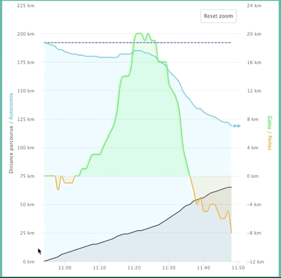

Sur ce même panneau, un tableau récapitule les étapes de la journée (conduite, charge, parking) : durées, consommation, vitesse, ... Les colonnes sont modifiables et peuvent être triées.

Une carte permet aussi de retracer l'ensemble des trajets d'une journée, de définir des favoris, et de suivre votre voiture à la trace depuis l'écran de votre Tesla !

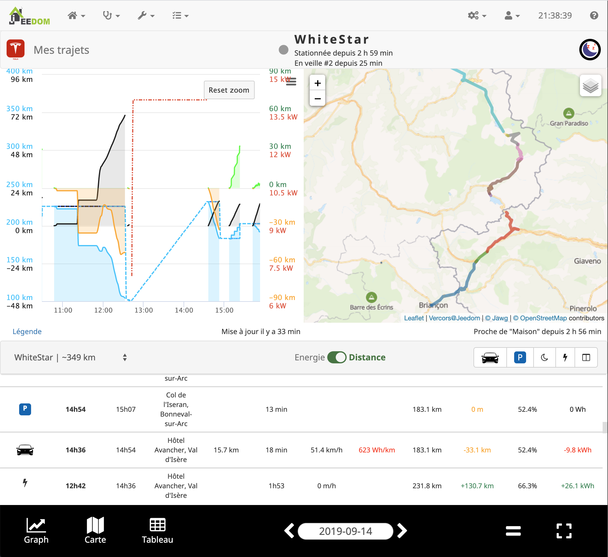

Et parce que ce plugin est une composante de votre système de domotique, votre Tesla rejoint tous les équipements de votre maison, pour des affichages ou des actions coordonnées.

Retrouvez la liste des nouveautés sur le [Change log](http://tesla.jeedom.free.fr/changelog).

## Démarrage rapide

1. Installez et activez le plugin depuis le market Jeedom.
2. [Créez une application Fleet API](#creer-application) sur votre compte Tesla.
3. [Connectez le plugin](#connecter-plugin) à votre compte Tesla : vos voitures sont ajoutées automatiquement.
4. Si les commandes ne s'exécutent pas, [appairez la voiture](#appairage) avec le plugin.
5. [Configurez le véhicule](#configuration-vehicule), puis [démarrez le suivi de l'autonomie](#tracking-mise-en-place).

> Pas encore de Tesla ? Vous pouvez [essayer le plugin avec des Tesla virtuelles](#tesla-virtuelles).

# Installation et connexion

> Depuis février 2025, Tesla rend obligatoire l'utilisation de vos propres clés pour accéder aux serveurs qui permettent de récupérer les données de vos véhicules et de leur envoyer des commandes (klaxon, démarrage de charge, réveil, ouverture de coffre, ...).

La connexion se fait en trois étapes : créer une "application" sur le site développeur de Tesla, connecter le plugin avec les clés de cette application, puis, pour les Tesla récentes, appairer la voiture. La page de connexion du plugin sur votre Jeedom vous donne les informations propres à votre installation.

## 1. Créer une application Fleet API {#creer-application}

Depuis votre compte Tesla, créez un compte "API Fleet" sur [https://developer.tesla.com](https://developer.tesla.com/fr_FR), puis remplissez le formulaire de création d'application.

**Étape 1 – Information sur l'application** : donnez un nom, une description et l'utilisation prévue. Peu importe, mais évitons que tout le monde indique "Jeedom" :)

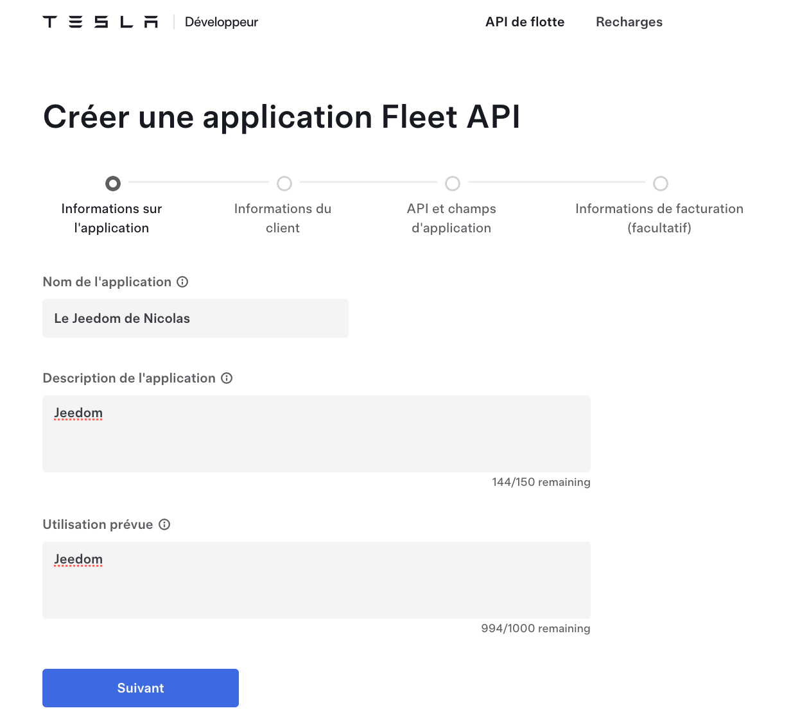

**Étape 2 – Informations du client** : cochez *"Code d'autorisation et accès de machine à machine"* et renseignez les deux premières URLs :

 - la première est le domaine qui héberge votre Jeedom. La page de connexion du plugin vous l'indique ;
 - la seconde est la page qui vous permettra de récupérer le code d'accès : `https://jeedomteslaplugin.firebaseapp.com/redirect/` ;
 - la troisième est optionnelle et inutile dans notre cas.

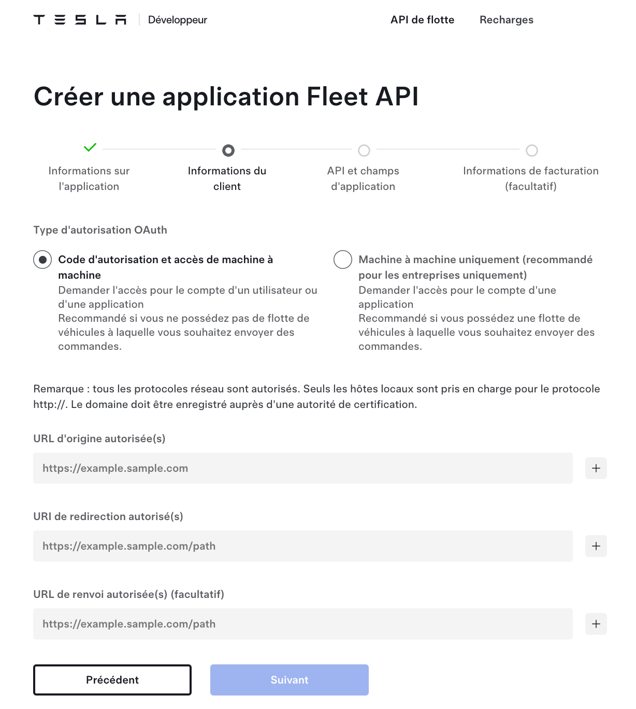

**Étape 3 – API et champs d'application** : cochez toutes les cases sauf les deux dernières, qui correspondent à l'exploitation des équipements de production d'énergie. Le plugin a besoin des informations du véhicule, de sa localisation, et des accès aux commandes et à la gestion de charge.

> Ces données restent en **local** sur votre serveur Jeedom. En aucun cas elles ne sont transmises à des tiers. En cochant ces cases, vous vous autorisez à utiliser vos informations. Vous n'autorisez personne d'autre.

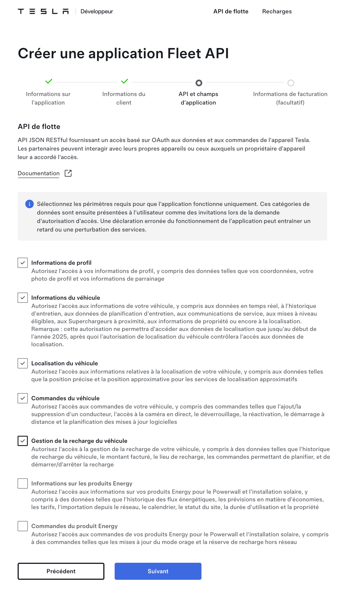

**Étape 4 – Informations de facturation** : cliquez simplement sur "Ignorer et soumettre".

> Si votre utilisation dépasse 10€ par mois (qui sont déduits des factures mensuelles) et que vous n'avez pas renseigné de moyen de paiement, Tesla se réserve le droit de désactiver votre compte.
>
> Le plugin permet de limiter l'usage de l'API pour qu'elle ne dépasse pas une certaine somme (voir [Coût mensuel](#parametres-couts)). Si vous indiquez 10€, le plugin ne contactera plus les serveurs Tesla jusqu'à la fin du mois.

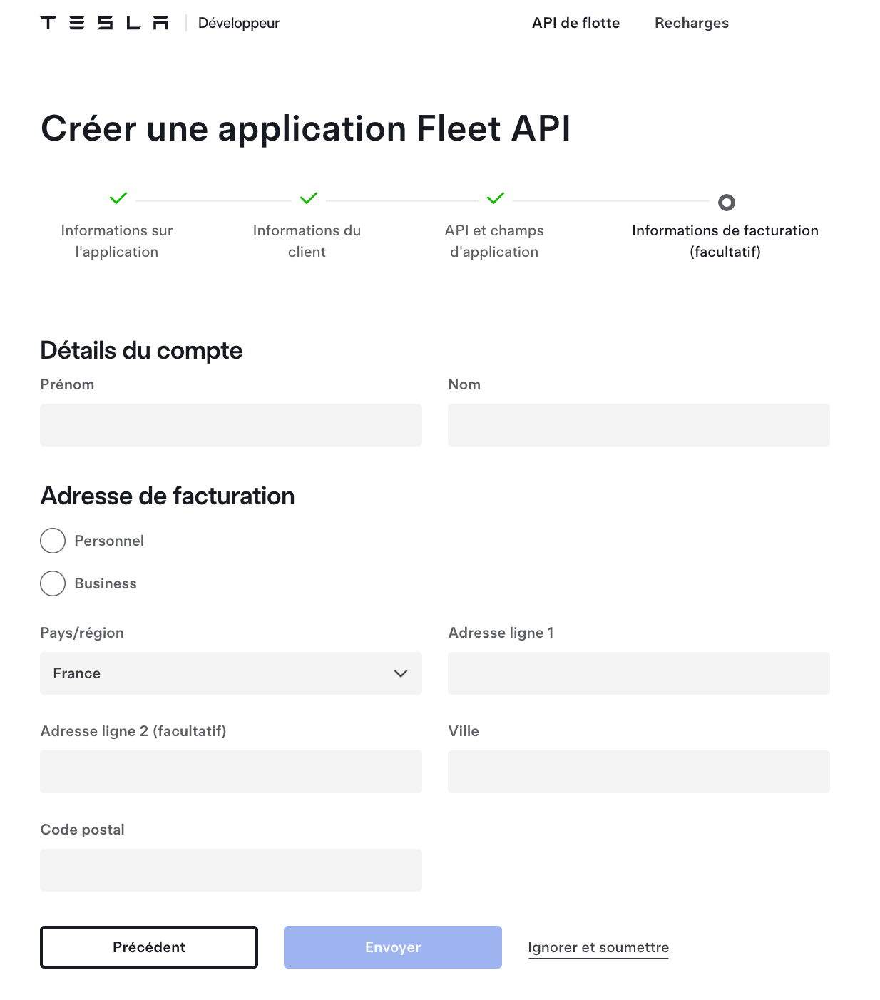

Vous recevrez ensuite un mail de Tesla vous indiquant que votre "application" est activée et disponible. Ses deux clefs sont alors visibles dans les détails de votre "application" :

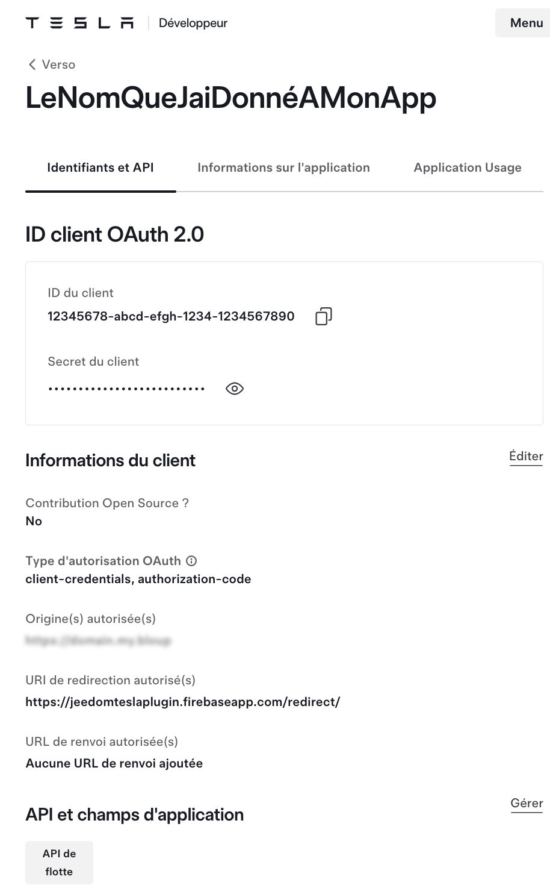

## 2. Connecter le plugin {#connecter-plugin}

**Renseigner les clés.** Dans le panneau de configuration du plugin Tesla sur votre Jeedom, renseignez :

 - votre *ID du client* dans `Client ID` ;
 - votre *Secret du client* dans `Client Secret` ;
 - l'*Origine(s) autorisée(s)* dans `URL d'origine autorisé`.

> Ces trois données ne doivent en aucun cas être transmises à un tiers.

Le bouton **Récupérer mon code d'authentification** devient alors accessible, dans la section "Connexion" du panneau.

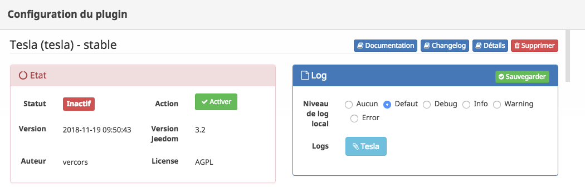

**Autoriser le plugin.** Pour interagir avec votre Tesla, le plugin a besoin d'un **code d'authentification**, fourni exclusivement par Tesla. Le bouton **Récupérer mon code d'authentification** vous amène sur le site auth.tesla.com, où vous vous identifiez sur votre compte Tesla :

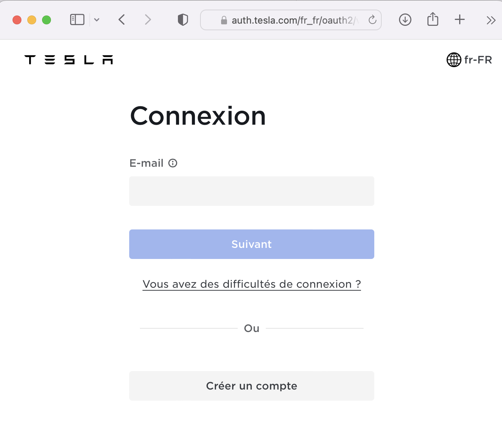

Accordez au plugin Tesla de Jeedom l'accès à vos informations de profil, de véhicule, aux commandes du véhicule et à la gestion de la recharge. Ne pas cocher l'un de ces éléments peut empêcher le plugin de fonctionner pleinement.

> Jeedom étant hébergé sur votre propre serveur, vous seul aurez accès aux données, stockées localement chez vous.

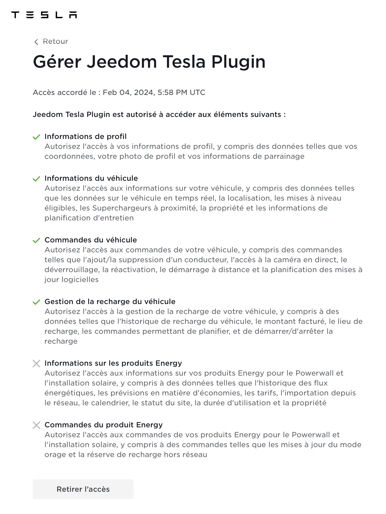

**Copier le code.** Le code d'authentification s'affiche sur une page dédiée. Copiez-le (icône à droite du code) et collez-le dans le panneau de configuration du plugin.

> Ce code est à usage unique. Il est inutile de le conserver : le plugin ne l'enregistre pas, il sert simplement à obtenir les premiers jetons d'authentification.

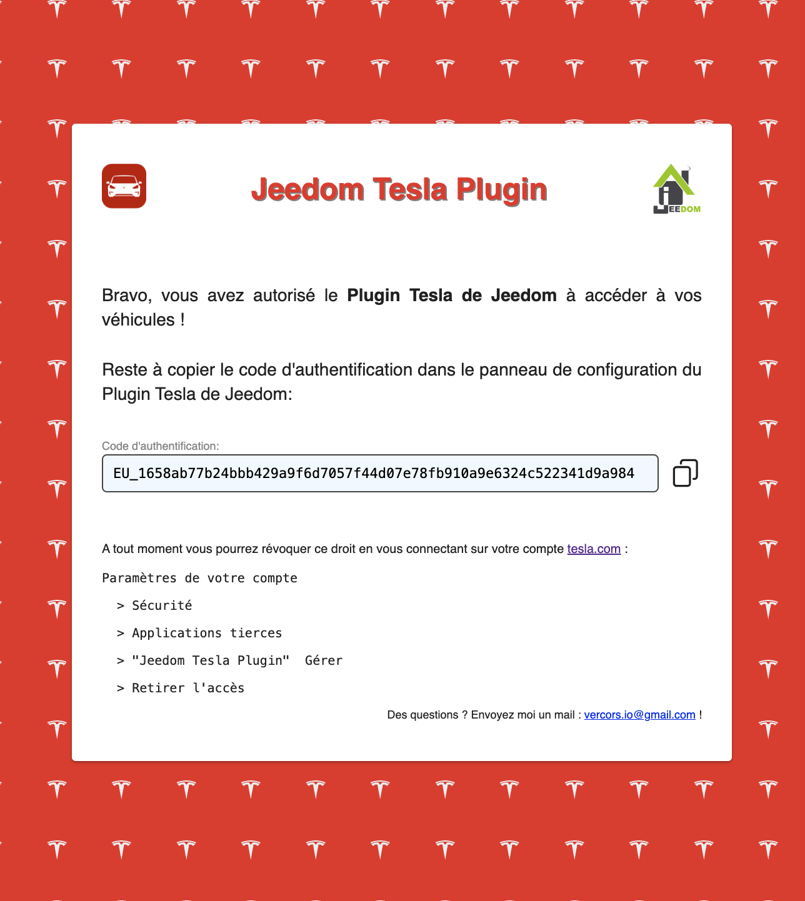

**Se connecter.** Cliquez sur "CONNEXION". Le plugin obtient deux jetons :

  * le **jeton d'accès**, utilisé dans les échanges avec les serveurs Tesla. Il est valide 8 heures ;
  * le **jeton de rafraichissement**, qui permet au plugin de remplacer automatiquement le jeton d'accès quand il expire.

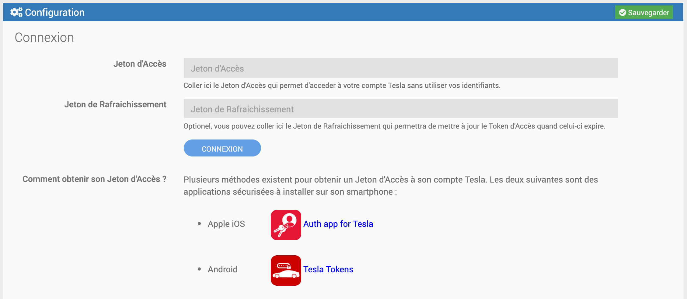

Le plugin récupère alors la ou les Tesla associées à votre compte et crée automatiquement les équipements Jeedom correspondants.

> **Notes**
>
>  - Votre Tesla doit être accessible sur le réseau pour que la configuration se passe correctement : assurez-vous qu'elle soit réveillée au moment de l'activation du plugin. Si l'application Tesla de votre smartphone arrive à se connecter à votre Tesla, le plugin y arrivera aussi.
>  - Le plugin Tesla de Jeedom **ne nécessite pas** les identifiants de votre compte Tesla. Ne les transmettez à personne.
>  - "Jeedom Tesla Plugin" apparaît désormais dans la liste des Applications tierces de votre compte Tesla. Le bouton "Gérer" permet de supprimer ce lien : le plugin n'aura alors plus accès à vos véhicules, et il faudra refaire cette étape.

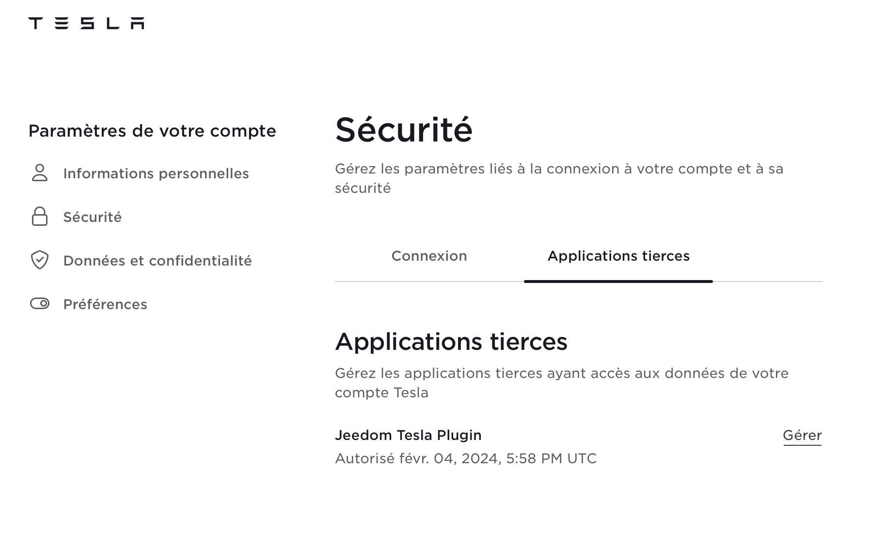

## 3. Appairer la voiture {#appairage}

Depuis 2024, les Tesla récentes exigent des *Commandes Signées*, un mode de connexion qui renforce la sécurité des commandes envoyées au véhicule. Le plugin détecte automatiquement si votre véhicule en a besoin. Dans ce cas, les commandes doivent passer par un **Serveur Proxy**, fourni par Tesla, qui tourne sur votre Jeedom.

Symptôme typique : les commandes ne s'exécutent pas depuis Jeedom et/ou les logs contiennent `unsigned_cmds_hardlocked`.

1. Depuis le panneau de configuration du véhicule, démarrez le Serveur Proxy sur un port défini (4443 par défaut).
2. Cliquez sur le bouton "Appairage de la Tesla". Un QR Code s'affiche. Une fois scanné, il ouvre l'application Tesla de votre smartphone (iOS ou Android) et vous demande de choisir le véhicule auquel ajouter la clef qui sécurisera l'envoi des commandes.
3. Envoyez des commandes (ouverture de coffre, climatisation, klaxon, ...) : elles sont transmises au Serveur Proxy local, qui les signe avant de les envoyer à la voiture via les serveurs Tesla.

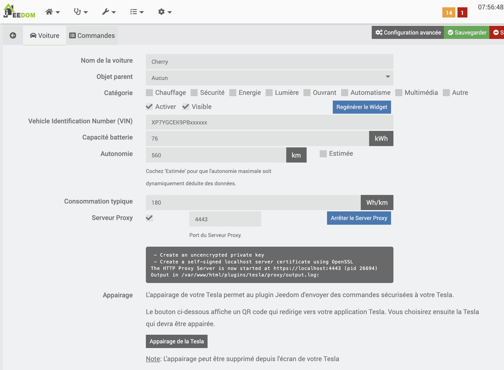

> **Notes**
>
>  - Le serveur peut être arrêté depuis la page de configuration de la voiture. S'il est arrêté au moment où une commande doit être envoyée, Jeedom tente de le redémarrer.
>  - La clef ajoutée dans votre Tesla lors de l'appairage peut être supprimée depuis l'écran de la voiture (menu Sécurité, liste des cartes d'accès au véhicule).

Le diagramme ci-dessous provient de la documentation du [Serveur Proxy](https://github.com/teslamotors/vehicle-command). Dans le contexte du plugin, il faut lire :

 - `Your Backend` : le code du plugin Jeedom, qui envoie des commandes au Serveur Proxy ;
 - `Vehicule Commands Proxy` : le Serveur Proxy démarré sur le port 4443. Il signe la commande et l'envoie aux serveurs Tesla ;
 - `Fleet API` : l'API Tesla présente sur les serveurs Tesla ;
 - `Vehicle` : votre Tesla.

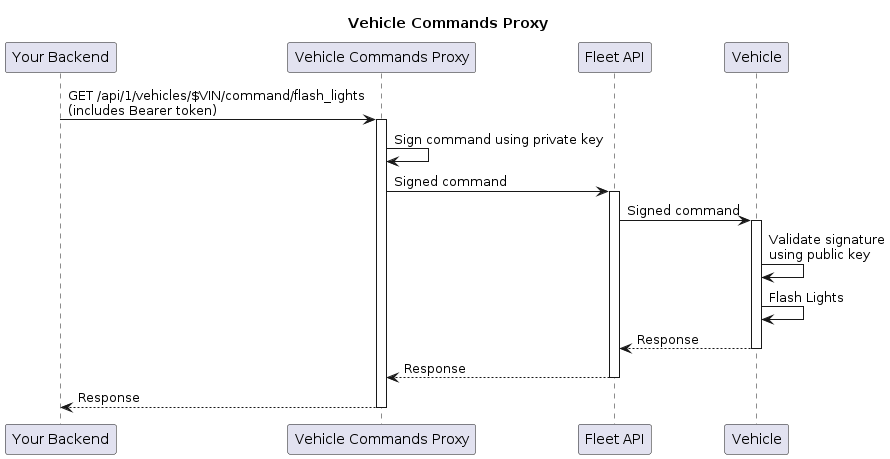

## Déconnexion

Une fois connecté, le plugin affiche un bouton de déconnexion. Les jetons d'accès sont alors révoqués auprès des serveurs Tesla et le plugin n'est plus fonctionnel. Pour vous reconnecter, il faudra à nouveau [récupérer un code d'authentification](#connecter-plugin).

## Essayer sans Tesla {#tesla-virtuelles}

Pour tester le plugin sans connexion à votre compte Tesla, ou si vous n'avez pas (encore) de Tesla, le plugin peut créer des équipements virtuels correspondant à des Tesla __Model 3__, __Model Y__, __Model S__ et/ou __Model X__.

Cliquez sur le bouton __"Ajouter des Tesla virtuelles"__ : des jeux de données issus de véhicules réels sont utilisés pour créer ces équipements. Bien entendu, toute action (chauffage, charge, déverrouillage) sur ces équipements est sans effet, mais ils feront bonne figure dans votre interface Jeedom.

# Configuration

## Configuration du plugin {#configuration-du-plugin}

Le bouton __"Synchroniser mes voitures"__ lance une recherche manuelle et ajoute un équipement Jeedom pour chaque Tesla non encore créée. Il permet aussi de mettre à jour vos équipements après une mise à jour du plugin.

**Démon.** Le suivi de l'autonomie repose sur un script qui tourne en arrière-plan. Son démarrage se pilote depuis le panneau de contrôle du plugin. Il est recommandé d'activer la **Gestion Automatique** pour que Jeedom le redémarre s'il s'arrête.

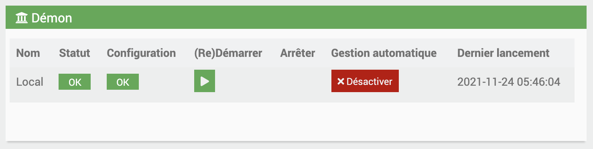

**Panneaux de suivi.** Pour accéder aux panneaux de suivi de l'autonomie (le "tracking"), cochez `Afficher le panneau desktop` et `Afficher le panneau mobile` :

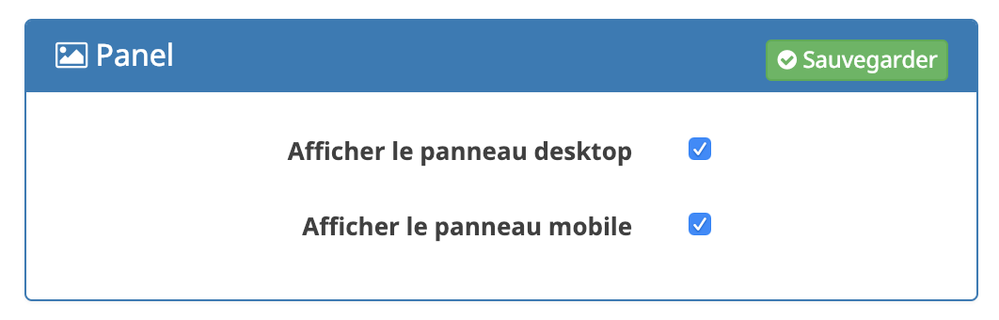

Après rechargement de la page, un sous-menu "Tesla" apparaît dans le menu "Accueil" et conduit au tracking :

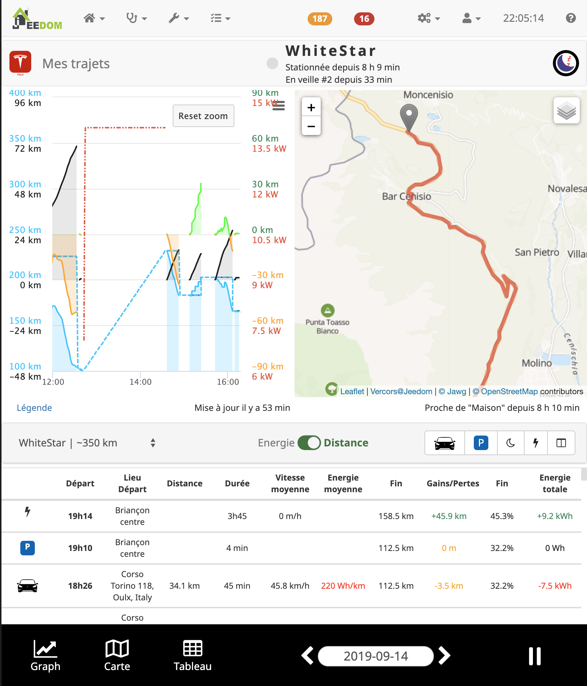

### Autres paramètres {#autres-parametres}

#### Connexion {#parametres-connexion}

| Paramètre | Description |
| --- | --- |
| **Client ID** / **Client Secret** | Les deux clefs personnelles de votre "application" créée sur [developer.tesla.com](https://developer.tesla.com) (voir [Créer une application Fleet API](#creer-application)). Elles ne doivent jamais être partagées. |
| **Région** | Le serveur Tesla régional utilisé (Amérique du Nord/Asie, Europe/Moyen-Orient/Afrique, Chine). Mis à jour automatiquement à la connexion. À modifier uniquement si l'erreur _Account must be registered in the current region_ apparaît dans les logs. |
| **Nombre de tentatives pour réveiller le véhicule** / **Nombre de secondes entre deux tentatives** | 3 tentatives espacées de 5 secondes par défaut. Utilisés par la commande **Réveiller** et par le réveil automatique avant l'envoi d'une commande. |
| **cronHourly** | S'il est activé, le plugin met à jour les données du widget une fois par heure. Quand le tracking est actif, elles sont mises à jour au fil de l'eau. |

#### Coûts {#parametres-couts}

| Paramètre | Description |
| --- | --- |
| **Coût du kWh** et **devise** | Prix du kWh (`0.14` par défaut) et devise associée. Sert à estimer le coût d'une charge, le prix pour parcourir 100km et le nombre de km parcourus avec 1 euro. |
| **Coût mensuel** (API Fleet) | Le montant maximal que vous acceptez que Tesla facture chaque mois pour l'usage de ses serveurs. Quand le coût estimé atteint ce seuil, **Info seuil mensuel atteint** passe à `1` et le plugin ne contacte plus les serveurs Tesla jusqu'à la fin du mois. Voir aussi la fenêtre [Fleet API](#fleet-api). |
| **Encours estimé** | L'encours du mois relevé sur votre [Dashboard Tesla](https://developer.tesla.com/fr_FR/dashboard), à une date et une heure données. Le coût estimé part de cet encours et ignore les appels enregistrés avant cette date. **Effacer l'encours** le remet à zéro. |

#### Carte et affichage {#parametres-carte}

| Paramètre | Description |
| --- | --- |
| **Clé API Maptiler** | Nécessaire pour traduire les lieux de parking en adresses et afficher les cartes (tracking, fenêtre Planifier). |
| **Pays par défaut** | Sur les adresses résolues, le pays n'est affiché que s'il est différent de cette valeur. |
| **Thème sombre** | Active un thème sombre pour le panneau de tracking, séparément en Desktop et en Mobile. |

#### Suivi de l'autonomie {#parametres-tracking}

| Paramètre | Description |
| --- | --- |
| **Intervalles et périodes** | Intervalles entre deux appels selon le mode du tracking, temps d'attente au parking et période du SOMMEIL NUIT. Voir [Modes et consommation](#tracking-modes). **Rétablir les valeurs par défaut** remet ces réglages à leur valeur d'origine. |
| **Scinder un trajet en deux** | Quand la voiture traverse une zone sans réseau (parking souterrain, ...) puis se gare, elle peut réapparaître alors qu'elle roule déjà. Le tracking coupe alors le trajet en deux si la durée _et_ la distance entre deux mesures successives dépassent les valeurs configurées. |
| **Consolidation des données** | Supprime de la base les points et parkings orphelins. |

## Configuration du véhicule {#configuration-vehicule}

Une fois le plugin connecté, le ou les véhicules de votre compte Tesla sont ajoutés.

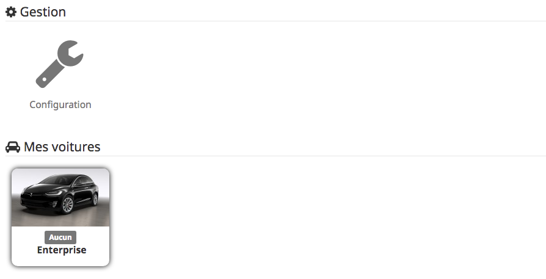

Un lien **Documentation** affiche cette documentation, et un lien **Aide** apporte un premier niveau d'aide en cas de besoin.

Pour configurer le véhicule, cliquez sur son image. Vous pouvez alors l'activer, le rendre visible et l'attacher à un objet parent (ici le Garage) :

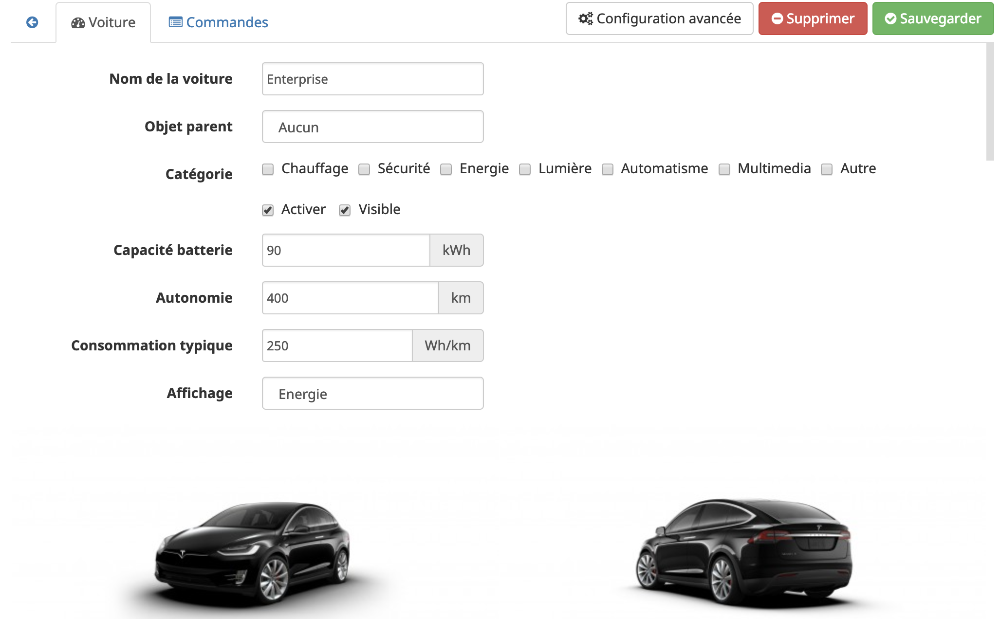

 * __Vehicle Identification Number (VIN)__ : champ obligatoire, qui identifie de manière unique votre véhicule auprès des serveurs Tesla.
 * __Capacité batterie__ : la capacité "commerciale" de la batterie en kWh.
 * __Autonomie__ : le nombre de kilomètres parcourus avec 100% d'autonomie. Cochez "Estimée" pour que le plugin la déduise des données de la voiture.
 * __Consommation typique__ : en théorie, `Capacité batterie x 1000 / Autonomie`. Ajustable selon vos propres constatations.

Pour changer l'image de votre voiture, choisissez le modèle et la couleur dans la liste "Modèle", puis cliquez sur l'image pour changer le visuel des roues.

# Le widget {#le-widget}

La plupart des commandes du véhicule ont un template spécifique, qui donne par défaut l'affichage suivant :

**Version Desktop**

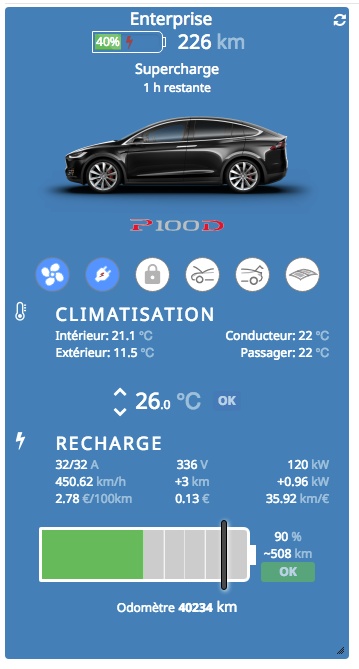

**Version Mobile**

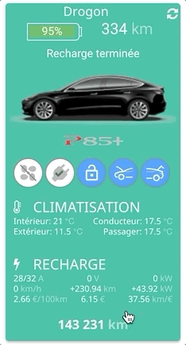

Pour masquer un élément (par exemple la photo ou les détails de climatisation), décochez `"Affichage"` sur la ligne de la commande correspondante, dans la configuration du véhicule. La liste complète des commandes est dans la [Référence des commandes](#reference-commandes).

L'odomètre est historisé, ce qui permet d'obtenir le graphique des km parcourus.

Par défaut, le widget est mis à jour toutes les heures. Pour désactiver cette mise à jour, décochez "Activer" en face de "cronHourly" :

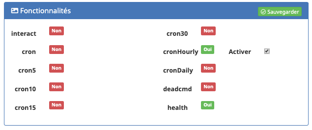

## Climatisation, sièges et volant chauffants

| Bouton | Description | Un clic sur ce bouton va ... |
| --- | --- | --: |
|  | La climatisation est éteinte | _... allumer la climatisation_ |
|  | La climatisation est allumée | _... éteindre la climatisation_ |
|  | Le volant ou un des sièges chauffants est allumé | _... ouvrir le panneau de contrôle des sièges chauffants_ |
|  | Aucun des sièges chauffants ni le volant n'est allumé | _... ouvrir le panneau de contrôle des sièges chauffants_ |

La température cible de la climatisation se modifie avec un widget spécifique :

L'icône de siège ouvre le panneau de contrôle du chauffage des sièges et du volant. Le nombre de rangées affiché dépend de la configuration du véhicule, et le volant n'apparaît que s'il est chauffant. Le bouton OFF éteint tout, le bouton OK valide les choix faits pour chaque siège et le volant :

> **Notes**
>
> - À cause d'une limitation de l'API Tesla, des températures différentes pour le conducteur et le passager ne peuvent être configurées que si elles sont déjà désynchronisées dans le véhicule (SYNC désactivé).
> - L'accès aux sièges chauffants n'est possible que si la climatisation est allumée.

## Verrouillage, coffres, toit ouvrant et sentinelle

| Bouton | Description |  Un clic sur ce bouton va ... |
| --- | --- | --: |
|  | La voiture est fermée | _... déverrouiller les portes_ |
|  | La voiture est ouverte | _... verrouiller les portes_ |
|  | Le coffre avant est fermé | _... ouvrir le frunk_ |
|  | Le coffre avant est ouvert | _... être sans effet_ |
|  | Le coffre arrière est fermé | _... ouvrir le coffre_ |
| 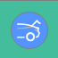 | Le coffre arrière est ouvert | _... fermer le coffre_ |
|  | Le toit panoramique est fermé | _... ouvrir le toit panoramique_ |
|  | Le toit panoramique est ouvert | _... fermer le toit panoramique_ |
|  | Le mode sentinelle est désactivé | _... activer le mode sentinelle_ |
|  | Le mode sentinelle est activé | _... désactiver le mode sentinelle_ |

## Charge

| Bouton | Description |  Un clic sur ce bouton va ... |
| --- | --- | ---: |
|  | Le câble de charge n'est pas branché | _... être sans effet_ |
|  | La recharge est programmée | _... démarrer la recharge_ |
|  | La recharge est en cours | _... stopper la recharge_ |
|  | La recharge a été manuellement arrêtée | _... reprendre la recharge_ |
|  | La recharge est terminée | _... être sans effet_ |
|  | État de recharge indéterminé | _... être sans effet_ |
|  | Trappe de recharge | _... fermer/ouvrir la trappe de recharge_ |

Pour modifier la limite de charge, déplacez le curseur sur le graphe de la batterie. Le pourcentage et le nombre approximatif de kilomètres s'affichent :

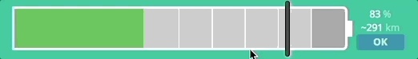

## Bouton du suivi de l'autonomie

| Bouton | Description |  Un clic sur ce bouton va ... |
| --- | --- | ---: |
|  | Le suivi de l'autonomie est arrêté | _... démarrer le suivi de l'autonomie_ |
|  | Le suivi de l'autonomie est démarré | _... arrêter le suivi de l'autonomie_ |
|  | Le suivi de l'autonomie est démarré en mode SOMMEIL jour | _... arrêter le suivi de l'autonomie_ |
|  | Le suivi de l'autonomie est démarré en mode SOMMEIL nuit | _... arrêter le suivi de l'autonomie_ |

> **Note**
>
> - Si la **Gestion Automatique** du démon est activée, Jeedom redémarre le démon s'il est arrêté : le tracking reste actif en permanence. Sinon, vous le démarrez et l'arrêtez manuellement.
> - Si la **Gestion Automatique** est désactivée, maintenez le bouton du tracking appuyé au moins 5 secondes pour faire apparaître le bouton __STOP__.

Le fonctionnement du tracking est détaillé dans la section [Suivi de l'autonomie](#suivi-autonomie).

# Suivi de l'autonomie {#suivi-autonomie}

Le *Suivi de l'autonomie* est aussi appelé *Range Tracking* ou simplement *tracking*.

## Principe

Le panneau de suivi de l'autonomie permet de comprendre l'influence de votre conduite et de l'environnement sur l'autonomie, pour chacune des Tesla activées dans votre Jeedom : évolution de l'autonomie restante au fil des trajets, des charges et des temps de repos, énergie consommée lors des trajets et emmagasinée lors des recharges.

Un graphique retrace l'évolution de l'autonomie ou de l'énergie au cours d'une journée, et un calendrier permet de consulter l'historique. Les données sont acquises depuis les serveurs Tesla par le démon du plugin, et stockées en **local** sur votre serveur Jeedom.

> **Notes**
>
> * Pratique, la version mobile permet de suivre l'évolution de l'autonomie ou de l'énergie tout en conduisant !
> * Pour accéder directement à la vue `Tesla` sur mobile, définissez-la comme vue "Mobile" par défaut dans votre profil (menu `User` -> `Profil Admin` -> onglet `Interface`).
> * Le suivi de l'autonomie peut être piloté depuis un scénario.

## Mise en place {#tracking-mise-en-place}

Par défaut, l'acquisition n'est pas démarrée. Commencez par afficher les panneaux de suivi (voir [Configuration du plugin](#configuration-du-plugin)).

- `Start Recording` démarre le démon, qui récupère à intervalles réguliers les données servant aux graphiques, à l'identification des étapes de la journée et aux statistiques.
- `Stop Recording` arrête l'acquisition des données (arrêt du démon).

Lorsque le démon est en mode **Gestion Automatique**, il n'est pas possible de l'arrêter ou de le démarrer manuellement.

> **Notes**
>
> - Pendant l'acquisition, si le graphe affiché est celui du jour, l'affichage bascule automatiquement en mode `live` et affiche en temps réel les dernières données.
> - Au premier lancement, plusieurs minutes peuvent s'écouler avant que des données soient disponibles.

## Modes et consommation {#tracking-modes}

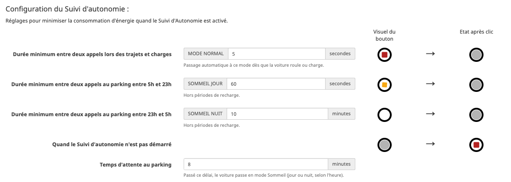

Quand le véhicule roule ou charge, les graphes donnent une idée très précise de l'évolution de l'autonomie. À l'arrêt au parking, en revanche, il est inutile de surveiller la voiture aussi finement.

| Mode | Quand | Intervalle par défaut |
| --- | --- | --- |
| `NORMAL` | La voiture roule ou charge | 60 s en conduite, 180 s en recharge |
| `SOMMEIL JOUR` | Au parking, après le `temps d'attente au parking` (10 min) | 15 min |
| `SOMMEIL NUIT` | Au parking, pendant la période de nuit (23h–5h) | 30 min |

Ces intervalles sont configurables, tout comme les heures de début et de fin du `SOMMEIL NUIT`. En mode SOMMEIL, les appels espacés laissent à la voiture la possibilité de se mettre en veille. Quand elle se remet à rouler ou à charger, le prochain appel détecte ce changement et repasse le tracking en mode `NORMAL`.

**Les deux appels de l'API Tesla.** Le tracking utilise deux appels pour interroger le véhicule :

 - `vehicle` indique seulement l'état de la voiture : `online`, `offline`, `asleep`, `waking` ou `unknown`. Cet appel n'est pas intrusif : il n'entre pas en contact avec la voiture. `online` signifie que la voiture roule, charge, télécharge une mise à jour, effectue une opération interne... mais elle peut aussi être `online` au parking, en attendant de s'endormir (`offline`/`asleep`). Hélas, cet appel ne distingue pas un `online "actif"` (roulage, charge) d'un `online "inactif"` (au parking avant le sommeil).
 - `data` remonte toutes les données à jour du véhicule. Il n'est possible que si la voiture est `online`, et le solliciter trop souvent l'empêche de passer `offline`.

Avant chaque appel `data`, le tracking effectue un appel `vehicle`. Si la voiture est `offline` ou `asleep`, le tracking la laisse dormir et n'effectue pas d'appel `data`. Sinon, il effectue l'appel `data` et stocke un nouveau jeu de données pour les graphes et les statistiques.

**Exemple d'une journée type** :

  - La voiture roule : le tracking enregistre les données au fil de l'eau, en mode NORMAL.
  - La voiture se gare : le tracking reste en mode NORMAL pendant 10 minutes, prêt à enregistrer le prochain trajet.
  - Passées ces 10 minutes, le tracking passe en mode SOMMEIL et n'interroge plus la voiture que toutes les 15 minutes, lui laissant la possibilité de se mettre en veille.
  - Dès que la voiture est en veille, le tracking le détecte, arrête tout enregistrement et surveille simplement son état (appel `vehicle`), qui reste `offline` pendant toute la veille.
  - Quand l'état repasse `online`, le tracking repasse en mode NORMAL, prêt à enregistrer un trajet ou à commencer une nouvelle attente de 10 minutes.

> **Notes**
>
> - La voiture décide seule de se mettre en veille, après 15 à 20 minutes sans sollicitation : le plugin ne peut pas le lui demander. Elle en sort quand elle est ouverte, conduite, mise en charge, sollicitée par une application (y compris l'app officielle Tesla ou le widget iOS), ou pour des besoins internes (températures extrêmes, mise à jour, ...).
> - En mode SOMMEIL, un départ entre deux appels n'est pas détecté : on peut "perdre" jusqu'à 14 minutes de trajet. Un clic sur l'icône orange du tracking le remet manuellement en mode NORMAL.
> - Activer le tracking en continu peut entraîner une consommation d'énergie non souhaitée.

## Lire le graphe en mode distance

L'exemple ci-dessous retrace un trajet réel effectué le 5 janvier 2019, en 4 segments :

- <code>km  0</code> à <code>km 15</code> : route départementale sur du plat - _altitude 'en haut' : 1100m._
- <code>km 15</code> à <code>km 30</code> : route départementale en descente - _altitude 'en bas' : 250m._
- <code>km 30</code> à <code>km 50</code> : autoroute.
- <code>km 50</code> à <code>km 65</code> : route départementale - _altitude à l'arrivée : 500m._

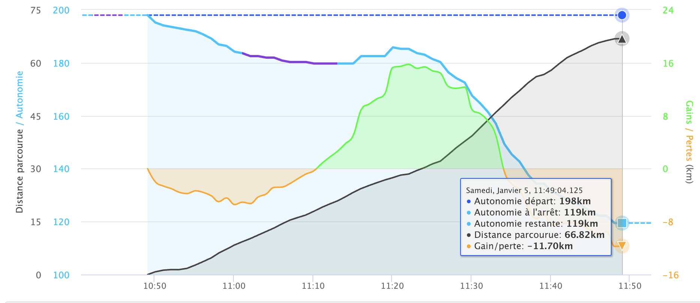

- En abscisse, le temps.
- En ordonnée à gauche en <b>noir</b>, le kilométrage parcouru. La pente de la courbe est proportionnelle à la vitesse.
- En ordonnée à gauche en <b style='color:#22C4FF'>bleu</b>, l'autonomie de départ en <b style="color:#3355FF">pointillé</b>, et l'évolution de l'autonomie en <b style='color:#22C4FF'>bleu</b>. Quand la climatisation est allumée, le trait est <b style='color:blueviolet'>violet</b>.
- En ordonnée à droite, la différence entre l'<b style="color:#3355FF">autonomie initiale</b> et l'<b style='color:#22C4FF'>autonomie réelle</b> compte tenu des <b>kilomètres parcourus</b> : courbe <b style="color:#00FF00">verte</b> en cas de gain, <b style="color:#FFA500">orange</b> en cas de perte. Pendant une recharge, la courbe affiche la <b style="color:#E74C3C">puissance de charge</b>.

Un tableau récapitulatif de la journée permet, en sélectionnant une ligne, de zoomer sur la partie correspondante du graphe. Un clic sur la ligne "Total" affiche la journée complète.

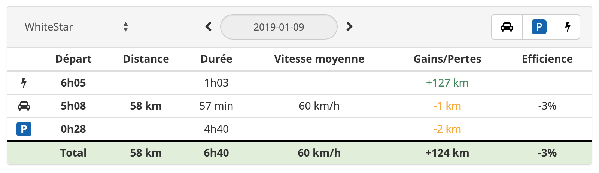

- L'`efficience` est le pourcentage de km gagnés/perdus par rapport à la longueur du trajet, ce qui permet de pondérer les résultats. Les petits trajets sont 'énergivores'.
- Les trois boutons en haut à droite du tableau filtrent par type d'étape, pour calculer par exemple les pertes liées aux seules étapes de type `parking`.

## Lire le graphe en mode énergie

Le sélecteur permet de basculer entre les modes `distance` et `énergie`. En mode énergie, la courbe <b style="color:#00FF00">verte</b>/<b style="color:#FFA500">orange</b> laisse place au cumul de l'énergie consommée/produite, avec trois zones :

* la <b style="color:#FF0000">sur-consommation</b>, au-delà de la consommation typique (ici `220Wh/km`) ;
* la <b style="color:#FFA500">sous-consommation</b> ;
* la <b style="color:#00FF00">production</b>, lorsque le cumul de l'énergie est négatif.

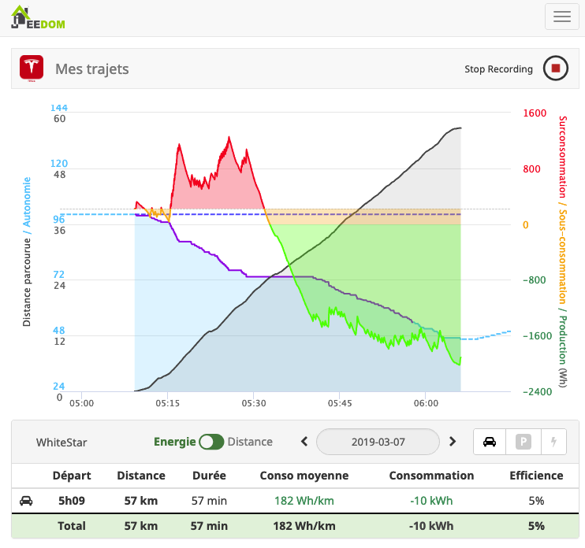

Le tableau affiche les informations d'énergie : en <b style="color:darkgreen">vert</b> lorsque le trajet a consommé en moyenne moins que le typique, en <b style="color:#FF0000">rouge</b> sinon.

> **Note**
>
> En dehors des trajets, le graphique affiche l'évolution de l'autonomie à l'arrêt : il permet par exemple de tracer les pertes de type <i>"vampire drain"</i> et de voir les courbes lors des recharges.

# Cartographie {#cartographie}

La cartographie permet :

 - de traduire les lieux de parking en adresses physiques ;
 - d'afficher sur le tableau du tracking les lieux de départ et d'arrivée ;
 - de définir un lieu de parking en favori ;
 - d'utiliser, dans un scénario, les événements émis lorsque la voiture entre ou sort d'un favori ;
 - d'afficher les trajets sur une carte, chacun d'une couleur différente ;
 - de suivre la voiture sur la carte pendant ses déplacements ;
 - de rejouer un trajet en suivant la pastille sur la carte et sur le graphe d'autonomie.

> La traduction en adresses nécessite une [clé API Maptiler](#autres-parametres).

## Éditer un favori

Le menu en haut à droite affiche sur la carte tous les lieux de parking et/ou ceux transformés en favori.

Le marqueur d'un parking peut être déplacé pour le positionner au bon endroit. Un clic sur ce marqueur, puis sur le "coeur", le transforme en favori.

Sur la carte ci-dessous, un arrêt a été fait au Col du Lautaret (trajet rouge puis trajet vert). Ce lieu peut être défini comme favori, avec un rayon d'action. La prochaine fois que la voiture entrera ou sortira de cette 'bulle', un événement Jeedom sera émis, qui peut déclencher un scénario (ouverture de portail, éclairage, ...).

## Les différentes formes de la pastille

Sur la carte, la pastille qui représente la voiture change de forme selon son état :

| Pastille | État |
| --- | --- |
|  | la voiture est en veille sur un parking |
|  | la voiture est en ligne sur un parking |
|  | la voiture est en cours de recharge |
|  | la voiture roule |

# Outils du plugin

En haut de la page du plugin, à côté des liens **Aide** et **FAQ**, trois boutons ouvrent des fenêtres dédiées.

## Fleet API {#fleet-api}

La fenêtre **Fleet API** estime le coût des appels faits par le plugin aux serveurs Tesla, par année, par mois et par jour, avec des graphiques du coût cumulé par rapport au seuil mensuel configuré. Les appels sont classés par type : données, commandes, sorties de veille et transmission de signaux.

L'**encours estimé** peut aussi être saisi depuis cette fenêtre (voir [paramètres de coûts](#parametres-couts)).

> **Notes**
>
> - Seules les requêtes envoyées par le plugin Tesla de Jeedom sont comptabilisées. Les appels faits par d'autres applications avec vos clés n'apparaissent pas.
> - L'estimation ne tient pas compte de la remise mensuelle de 10€ accordée par Tesla.
> - Le coût réel est consultable sur votre [Dashboard Tesla](https://developer.tesla.com/fr_FR/dashboard). Ajustez l'encours en conséquence.

## Recharges {#recharges}

La fenêtre **Recharges** liste vos sessions de recharge aux Superchargeurs Tesla :

- regroupement par **année**, par **mois** ou par **jour** ;
- filtres par véhicule, par pays, par période (avant / après une date) et recherche libre (lieu, véhicule...) ;
- totaux, moyennes et extrêmes (session la plus longue, coût et énergie maximum) sur les sessions filtrées ;
- téléchargement de la facture PDF de chaque session.

Les montants facturés dans une autre devise sont convertis et affichés en euros.

## Planifier {#planifier}

La fenêtre **Planifier** gère, directement depuis Jeedom, les plages programmées de votre Tesla :

- **Recharge** : heure de début et/ou heure de fin de la recharge ;
- **Préconditionnement** : heure à laquelle l'habitacle doit être prêt.

Chaque plage est affichée sous forme de carte, et son lieu apparaît sur la carte en haut de la fenêtre. Pour chaque plage, vous pouvez :

- l'activer ou la désactiver ;
- choisir les jours de la semaine et la répéter chaque semaine ;
- modifier ses horaires (icône crayon) ;
- déplacer son marqueur sur la carte pour changer le lieu où elle s'applique ;
- la supprimer (après confirmation).

Les boutons **+ Recharge** et **+ Préconditionnement** ajoutent une nouvelle plage.

> **Note**
>
> Les plages sont lues et écrites directement dans la voiture : elle doit être en ligne. Le plugin le vérifie avant de rechercher les plages programmées.

# Scénarios {#scenarios}

Chaque commande d'action peut être utilisée dans un scénario Jeedom. Quelques exemples :

**Mettre la limite de recharge à son maximum**

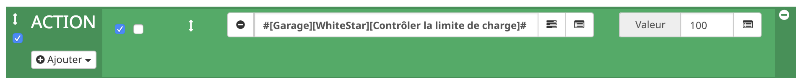

**Réveiller la voiture, mettre la limite de charge à 90% et allumer la climatisation si l'habitacle est en dessous de 14°C**

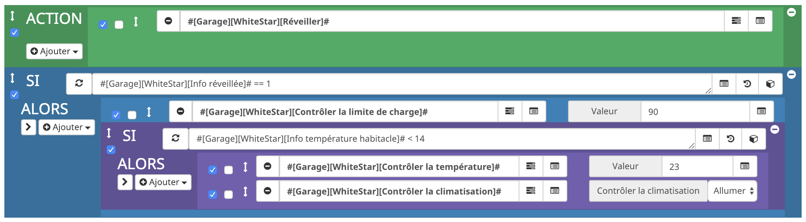

> Depuis la version 3.3.12, le plugin réveille automatiquement la voiture avant d'envoyer une commande. L'action **Réveiller** reste utile pour lire des infos à jour (ici la température de l'habitacle) avant de décider d'une action.

**Programmer le départ de la charge pour avoir 90% de batterie à 7h00**

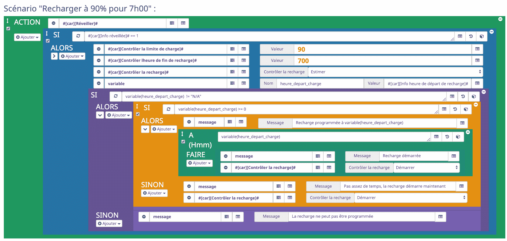

> **Note**
>
> Pour connaître l'heure de début de la recharge, démarrez la charge avec l'action `Estimer` : elle lance une courte charge pour estimer le temps nécessaire.
>
> - Si la voiture n'est pas prête pour la charge, **Info heure de départ de recharge** retourne `N/A`.
> - Si le temps estimé est inférieur au temps restant avant l'heure de fin de recharge, **Info heure de départ de recharge** retourne l'heure de départ au format `Hmm`.
> - S'il n'y a pas assez de temps pour atteindre le pourcentage voulu à l'heure programmée, l'heure de départ est précédée du signe `-`.
>
> Exemples pour avoir la voiture chargée à **90%** à **7h du matin**, avec un scénario lancé à 22h30 :
> - la recharge demande **5 heures et 30 minutes** : la commande retourne `130` (démarrage de la charge conseillé à 1h30) ;
> - la recharge demande **12 heures** : la commande retourne `-1900` (démarrage conseillé à 19h, mais il est trop tard !).

> **Le format Hmm**
>
> Les heures sont exprimées au format **Hmm** dans les commandes et les blocs d'action des scénarios :
>  - `2305` indique 23h05,
>  - `18` indique 00h18,
>  - `1200` indique 12h00,
>  - `1210` indique 12h10,
>  - `121` indique 1h21.

# Référence des commandes {#reference-commandes}

Les commandes d'info et d'action associées à chaque Tesla sont visibles dans l'onglet Commandes de l'équipement :

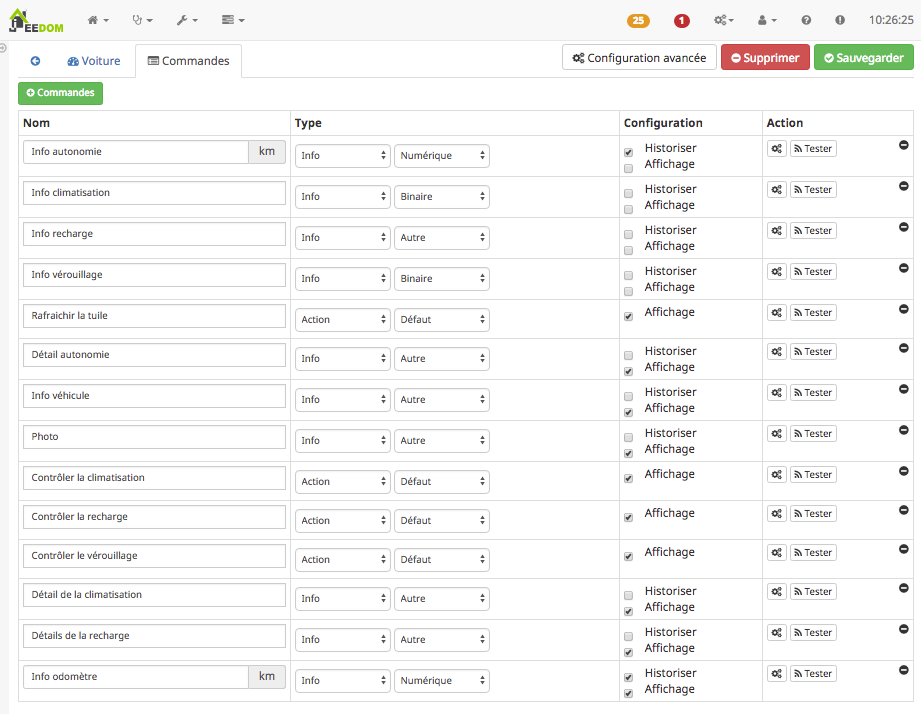

Les commandes marquées _(si équipé)_ ne sont créées que pour les véhicules qui disposent de l'équipement correspondant.

## Commandes de type info

### État du véhicule

| Commande | Description |
| --- | --- |
| **Photo** | Affiche une photo de la Tesla, ainsi que le badge (70D, P85D, ...). |
| **Info véhicule** | Affiche un titre et un sous-titre correspondant à l'état actuel de la voiture. Par exemple _Conduite 67km_, _Recharge planifiée à 22h50_, _Stationnée_, _Supercharge_, ... |
| **Info état vehicule** | État de la voiture déterminé par le tracking : `driving`, `charging` ou `parking`. |
| **Info réveillée** | Indique si le véhicule est en veille (0) ou en ligne (1). |
| **Info date dernière mise à jour** | Date des dernières données remontées par la voiture. |
| **Dernière mise à jour** | Timestamp de la dernière synchronisation horaire avec les serveurs Tesla. |
| **Odomètre** | Valeur du compteur kilométrique (miles ou km). |
| **Info vitesse** | Vitesse de la voiture (en km/h). Négative en marche arrière. |
| **Info selecteur de vitesses** | Indique P, R, N ou D. |

### Batterie et recharge

| Commande | Description |
| --- | --- |
| **Info autonomie** | Autonomie typique (en km ou miles). |
| **Info autonomie nominale** | Autonomie nominale (en km ou miles). |
| **Info niveau de batterie** | Pourcentage de la batterie. |
| **Détail autonomie** | Affiche un graphe de la batterie. |
| **Info recharge** | État de la charge : `Charging`, `Stopped`, `Disconnected`, `Complete`, `Scheduled` ou `Driving`. |
| **Info cable connecté** | Indique si le câble de recharge est connecté. |
| **Info trappe de recharge** | Indique si la trappe de recharge est ouverte (1) ou fermée (0). |
| **Info limite de recharge** | Pourcentage à atteindre à la fin d'une recharge. |
| **Info puissance de recharge** | Puissance de recharge (en kW). |
| **Info tension de recharge** | Tension de recharge (en volts). |
| **Info ampérage de recharge** | Intensité de charge réelle (en ampères). |
| **Info ampérage demandé** | Intensité de charge demandée à la voiture (en ampères). Modifiable avec **Contrôler l'ampérage de la recharge**. |
| **Info ampérage maximum** | Intensité maximale que peut fournir la borne (en ampères). |
| **Info durée de recharge estimée** | Durée restante estimée de la charge (en minutes). |
| **Info heure de départ de recharge** | Heure (format Hmm) à laquelle la charge est censée débuter. Voir l'[exemple de scénario](#scenarios). |
| **Info heure de fin de recharge** | Heure (format Hmm) à laquelle la charge est censée se terminer. |
| **Détail de la recharge** | Affiche les données de la recharge. |

### Climatisation

| Commande | Description |
| --- | --- |
| **Info climatisation** | Indique si la climatisation est allumée ou éteinte. |
| **Info température habitacle** | Température à l'intérieur du véhicule. |
| **Détail de la climatisation** | Affiche les paramètres de climatisation (conducteur, passager, intérieur et extérieur). |

### Ouvrants et sécurité

| Commande | Description |
| --- | --- |
| **Info verrouillage** | Indique si la voiture est fermée ou ouverte. |
| **Info frunk** | Indique si le coffre avant (frunk) est fermé ou ouvert. |
| **Info trunk** | Indique si le coffre arrière est fermé ou ouvert. |
| **Info fenêtres** | État des 4 fenêtres (avant conducteur, avant passager, arrière passager, arrière conducteur), une lettre par fenêtre : `F` fermée, `P` partiellement ouverte (entrouverte), `O` ouverte. Exemples : `FFFF` toutes fermées, `PPPP` toutes entrouvertes. _(si équipé)_ |
| **Info toît ouvrant** | Pourcentage d'ouverture du toit panoramique. _(si équipé)_ |
| **Info sentinelle** | Indique si le mode sentinelle est activé (1) ou non (0). _(si équipé)_ |

### Logiciel

| Commande | Description |
| --- | --- |
| **Info mise à jour logicielle** | Statut de la mise à jour en attente (par exemple `available`, `scheduled`, `downloading`, `installing`). Vide si aucune mise à jour n'est proposée. |
| **Détail logiciel** | Version logicielle actuelle et mise à jour proposée. |

### Position et favoris

| Commande | Description |
| --- | --- |
| **Info latitude** / **Info longitude** | Position GPS de la voiture. |
| **Info date de géolocalisation** | Timestamp de la dernière position GPS connue. |
| **Info s'approche de** | Nom du favori dont se rapproche la voiture. |
| **Info s'éloigne de** | Nom du favori dont s'éloigne la voiture. |
| **Info date dernier franchissement** | Timestamp de l'heure à laquelle la frontière du dernier favori a été franchie. |
| **Info éloigné de** | Favori choisi avec l'action **Calculer la distance**. |
| **Info distance** | Distance (en mètres) entre la voiture et le favori choisi avec **Calculer la distance**. Mise à jour à chaque changement de position. |

### Tracking et API

| Commande | Description |
| --- | --- |
| **Info suivi d'autonomie** | Indique si le tracking est démarré (1) ou arrêté (0). |
| **Info mode du tracking** | Mode actuel du tracking : `NORMAL`, `ADJUST`, `PARKING_DAY` (SOMMEIL JOUR), `PARKING_NIGHT` (SOMMEIL NUIT), `DATA` (voiture hors ligne), `SYNC`, `OFF`, ou `REACHED` quand le seuil mensuel de coût de l'API est atteint. |
| **Info seuil mensuel atteint** | Passe de `0` à `1` quand le coût estimé de l'API Fleet atteint le seuil mensuel configuré. Le plugin ne contacte alors plus les serveurs Tesla jusqu'à la fin du mois. |
| **Détail data** | Pour le debug : buffer encodé en base64, débarrassé de toute info personnelle (VIN/id/GPS/...). Renseigné uniquement quand les logs du plugin sont en niveau `debug`. |

## Commandes de type action

### Recharge

| Commande | Description |
| --- | --- |
| **Contrôler la recharge** | Démarre, interrompt, permute ou estime la charge si le câble est branché. Valeurs : `Arrêter`, `Démarrer`, `Permuter`, `Estimer`. |
| **Contrôler la limite de recharge** | Définit le pourcentage de charge à atteindre. |
| **Contrôler la trappe de charge** | Ouvre/ferme la trappe de recharge. |
| **Contrôler l'ampérage de la recharge** | Définit l'intensité du courant de charge (min 5A). |
| **Contrôler l'heure de fin de recharge** | Définit l'heure (format Hmm) à laquelle la charge doit se terminer. |

### Climatisation et chauffage

| Commande | Description |
| --- | --- |
| **Contrôler la climatisation** | Allume ou arrête la climatisation. |
| **Contrôler la température** | Définit la température de l'habitacle (conducteur/passager). |
| **Contrôler le chauffage du siège conducteur** / **passager** | Règle le chauffage du siège : `Arrêter`, `Faible`, `Moyen`, `Fort`. _(si équipé)_ |
| **Contrôler le chauffage du siège arr gauche** / **arr central** / **arr droit** | Idem pour les sièges arrière. _(si équipé)_ |
| **Contrôler le chauffage du siège coffre gauche** / **coffre droit** | Idem pour la troisième rangée. _(si équipé)_ |
| **Contrôler le chauffage du volant** | Allume ou éteint le volant chauffant. _(si équipé)_ |

### Ouvrants et sécurité

| Commande | Description |
| --- | --- |
| **Contrôler le verrouillage** | Verrouille ou déverrouille la voiture. |
| **Contrôler le coffre avant** | Ouvre le coffre avant (frunk). |
| **Contrôler le coffre arrière** | Ouvre ou ferme le coffre arrière (trunk). |
| **Contrôler les fenêtres** | Entrouvre ou ferme les fenêtres. `Permuter` les ferme si elles sont toutes entrouvertes (`PPPP`), et les entrouvre sinon. _(si équipé)_ |
| **Contrôler le toît ouvrant** | Entrouvre ou ferme le toit panoramique. _(si équipé)_ |
| **Contrôler le mode sentinelle** | Démarre ou arrête le mode sentinelle. _(si équipé)_ |
| **Actionner les phares** | Fait clignoter les phares. |
| **Actionner le klaxon** | Actionne l'avertisseur sonore. |

### Tracking et divers

| Commande | Description |
| --- | --- |
| **Contrôler le suivi de l'autonomie** | Démarre ou arrête le tracking. Valeurs : `Arrêter`, `Démarrer`, `Permuter`, `Accélérer` (repasser en mode NORMAL), `Ralentir` (passer en mode SOMMEIL). |
| **Contrôler le tracking** | Bouton du widget pour le tracking. Si la **Gestion Automatique** du démon est activée, il accélère ou ralentit le tracking ; sinon il le démarre ou l'arrête. |
| **Calculer la distance** | Choisit un favori. La distance entre la voiture et ce favori est alors remontée dans **Info distance**. |
| **Rafraichir** | Met à jour la tuile (clic sur l'icône). |
| **Réveiller** | Force le réveil de la voiture (par défaut 3 tentatives espacées de 5s, [configurable](#autres-parametres)). Met à jour **Info réveillée**. Inutile avant une commande d'action : le plugin réveille automatiquement la voiture si nécessaire. |

# Dépannage

## Santé

L'écran **Santé** (menu Analyse / Santé) lance un ensemble de vérifications pour s'assurer que le plugin Tesla est bien configuré. Si un problème de permission est détecté, il est corrigé.

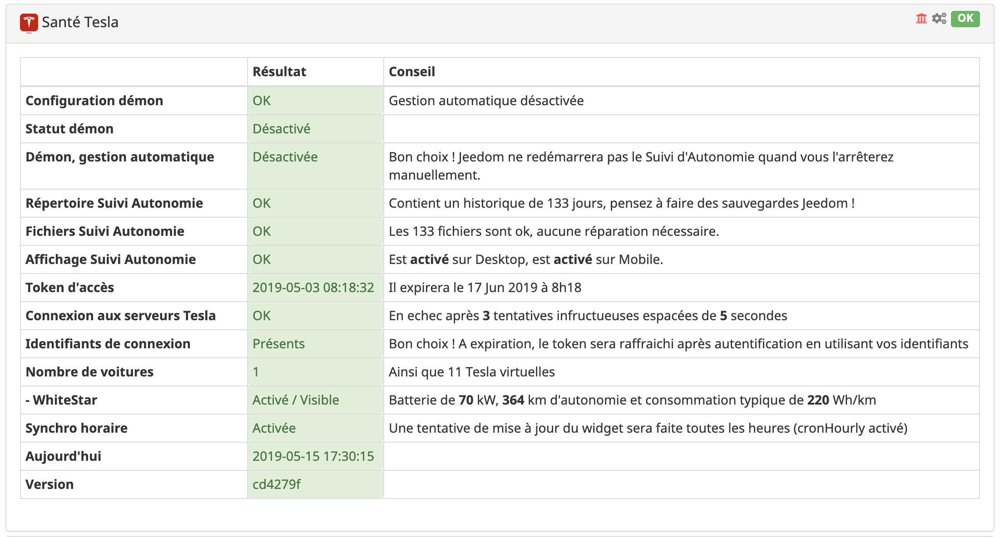

## FAQ {#faq}

### Comment bénéficier des nouvelles fonctionnalités après une mise à jour du plugin ?

Lors de la mise à jour, le plugin synchronise automatiquement vos véhicules. Si ce n'est pas le cas, cliquez sur le bouton `Synchroniser mes voitures` : les nouvelles commandes Info et Action sont ajoutées à l'équipement et visibles sur le dashboard.

### Comment changer les unités de température et de distance (°C / °F, km / miles) ?

Le plugin lit et utilise les paramètres configurés dans votre voiture. Idem pour l'affichage de l'autonomie typique ou nominale.

### La commande 'Réveiller' ne réveille pas la voiture.

Dans le panneau de configuration du plugin, augmentez `Nombre de tentatives pour réveiller le véhicule` (3 par défaut) et/ou `Nombre de secondes entre deux tentatives` (5 par défaut). Ces paramètres sont aussi utilisés par le réveil automatique avant l'envoi d'une commande.

### Est-ce que le tracking permet à la voiture de se mettre en veille ?

Oui, le plugin cherche à favoriser la mise en veille dès que possible : au parking, il espace ses appels pour laisser la voiture s'endormir. Le détail est dans [Modes et consommation](#tracking-modes).

### Est-il possible de régler l'intensité de charge depuis le plugin ?

Oui ! La commande **Contrôler l'ampérage de la recharge** permet ce réglage, très utile pour augmenter ou diminuer la vitesse de charge dans un scénario, par exemple selon votre production photovoltaïque.

### Le plugin s'est déconnecté tout seul de mon compte Tesla. Pourquoi ?

Le plugin ferme la session lorsque les serveurs Tesla refusent durablement ses requêtes :

  - après plusieurs tentatives, les erreurs `401` (_Unauthorized_), `405` (_Not allowed_), `421` (_Incorrect region_) ou `423` (_Locked_) ;
  - l'erreur `403 account disabled: EXCEEDED_LIMIT`, qui indique que Tesla a désactivé votre compte API Fleet, en général parce que le plafond de facturation est dépassé sans moyen de paiement renseigné.

Consultez votre [Dashboard Tesla](https://developer.tesla.com/fr_FR/dashboard) pour vérifier l'état de votre "application" (et ajouter un moyen de paiement si besoin), puis [reconnectez le plugin](#connecter-plugin). Pour éviter un dépassement, configurez un [Coût mensuel](#parametres-couts).

# Liens utiles et soutien

 - Le site officiel du plugin : [Tesla Jeedom](http://tesla.jeedom.free.fr)
 - Les notes de mise à jour : [ChangeLog](http://tesla.jeedom.free.fr/changelog)
 - Le forum officiel du plugin : [Forum Community de Jeedom](https://community.jeedom.com/tags/plugin-tesla)
 - Une mine d'info sur le [Forum Automobile Propre](https://forums.automobile-propre.com/topic/piloter-sa-tesla-avec-jeedom-13412)
 - Une vidéo très démonstrative des possibilités du plugin, proposée par XavMax, un utilisateur du plugin : [video](https://www.youtube.com/watch?v=4p3vTRY0dNE)
 - Envie de poster un avis sur le plugin ? [Ajoutez le vôtre !](https://market.jeedom.com/index.php?v=d&p=market_display&id=3486)
 - Besoin d'une Tesla pour tester le plugin ? Utilisez mon lien de parrainage ! [http://ts.la/nicolas2320](https://www.tesla.com/fr_fr/referral/nicolas2320)
 - Envie de soutenir le développement du projet :

<form action="https://www.paypal.com/cgi-bin/webscr" method="post" target="_top" style='text-align:center'>
<input type="hidden" name="cmd" value="_s-xclick">
<input type="hidden" name="encrypted" value="-----BEGIN PKCS7-----MIIHHgYJKoZIhvcNAQcEoIIHDzCCBwsCAQExggEwMIIBLAIBADCBlDCBjjELMAkGA1UEBhMCVVMxCzAJBgNVBAgTAkNBMRYwFAYDVQQHEw1Nb3VudGFpbiBWaWV3MRQwEgYDVQQKEwtQYXlQYWwgSW5jLjETMBEGA1UECxQKbGl2ZV9jZXJ0czERMA8GA1UEAxQIbGl2ZV9hcGkxHDAaBgkqhkiG9w0BCQEWDXJlQHBheXBhbC5jb20CAQAwDQYJKoZIhvcNAQEBBQAEgYAO1XEXsW9hS4ce9v/cFSnwWbixcW7YqizP7sPU/fAOTBqE2x3fvIhzM1PYeRF2SsjBsucLuFmGu/od2Xi2P8IFB4SFLaAYmFOJdiX8rnFbJkPcFpjRaxJZTGgMMYa6pvX4qoK9NouciAV7qUpg/YcIvhZZJ7bWv4erii3lCUsJQzELMAkGBSsOAwIaBQAwgZsGCSqGSIb3DQEHATAUBggqhkiG9w0DBwQI+wGjMwa2iZyAeD/PGWhrE1F1WyGg1CTkEwdGPxcZTiFzbdwE/GZr0Yd6ETPCfIBNVA7PCwkP9i1aJKfJNz9rRPeBatez7xxZkr0rWWgnA9BjimsXXdoimvhObqp6hmMVwgI+w/gGVYNJVpuf0qHZDxgdmfQ8sko2KNvEXxyLF4ZBi6CCA4cwggODMIIC7KADAgECAgEAMA0GCSqGSIb3DQEBBQUAMIGOMQswCQYDVQQGEwJVUzELMAkGA1UECBMCQ0ExFjAUBgNVBAcTDU1vdW50YWluIFZpZXcxFDASBgNVBAoTC1BheVBhbCBJbmMuMRMwEQYDVQQLFApsaXZlX2NlcnRzMREwDwYDVQQDFAhsaXZlX2FwaTEcMBoGCSqGSIb3DQEJARYNcmVAcGF5cGFsLmNvbTAeFw0wNDAyMTMxMDEzMTVaFw0zNTAyMTMxMDEzMTVaMIGOMQswCQYDVQQGEwJVUzELMAkGA1UECBMCQ0ExFjAUBgNVBAcTDU1vdW50YWluIFZpZXcxFDASBgNVBAoTC1BheVBhbCBJbmMuMRMwEQYDVQQLFApsaXZlX2NlcnRzMREwDwYDVQQDFAhsaXZlX2FwaTEcMBoGCSqGSIb3DQEJARYNcmVAcGF5cGFsLmNvbTCBnzANBgkqhkiG9w0BAQEFAAOBjQAwgYkCgYEAwUdO3fxEzEtcnI7ZKZL412XvZPugoni7i7D7prCe0AtaHTc97CYgm7NsAtJyxNLixmhLV8pyIEaiHXWAh8fPKW+R017+EmXrr9EaquPmsVvTywAAE1PMNOKqo2kl4Gxiz9zZqIajOm1fZGWcGS0f5JQ2kBqNbvbg2/Za+GJ/qwUCAwEAAaOB7jCB6zAdBgNVHQ4EFgQUlp98u8ZvF71ZP1LXChvsENZklGswgbsGA1UdIwSBszCBsIAUlp98u8ZvF71ZP1LXChvsENZklGuhgZSkgZEwgY4xCzAJBgNVBAYTAlVTMQswCQYDVQQIEwJDQTEWMBQGA1UEBxMNTW91bnRhaW4gVmlldzEUMBIGA1UEChMLUGF5UGFsIEluYy4xEzARBgNVBAsUCmxpdmVfY2VydHMxETAPBgNVBAMUCGxpdmVfYXBpMRwwGgYJKoZIhvcNAQkBFg1yZUBwYXlwYWwuY29tggEAMAwGA1UdEwQFMAMBAf8wDQYJKoZIhvcNAQEFBQADgYEAgV86VpqAWuXvX6Oro4qJ1tYVIT5DgWpE692Ag422H7yRIr/9j/iKG4Thia/Oflx4TdL+IFJBAyPK9v6zZNZtBgPBynXb048hsP16l2vi0k5Q2JKiPDsEfBhGI+HnxLXEaUWAcVfCsQFvd2A1sxRr67ip5y2wwBelUecP3AjJ+YcxggGaMIIBlgIBATCBlDCBjjELMAkGA1UEBhMCVVMxCzAJBgNVBAgTAkNBMRYwFAYDVQQHEw1Nb3VudGFpbiBWaWV3MRQwEgYDVQQKEwtQYXlQYWwgSW5jLjETMBEGA1UECxQKbGl2ZV9jZXJ0czERMA8GA1UEAxQIbGl2ZV9hcGkxHDAaBgkqhkiG9w0BCQEWDXJlQHBheXBhbC5jb20CAQAwCQYFKw4DAhoFAKBdMBgGCSqGSIb3DQEJAzELBgkqhkiG9w0BBwEwHAYJKoZIhvcNAQkFMQ8XDTIwMDMxMDA2NTYyOVowIwYJKoZIhvcNAQkEMRYEFGWyZKp8bL8wlJgrIkaQNtdS6D0DMA0GCSqGSIb3DQEBAQUABIGAd/tg09Lg6kPmmCmUMzYJsPKsG5fM6EJFEPTzmDP/g1fyUlfGXpL+B7AkKFYR6gIUKdZlCfoj0ZGrq1TwSI95wb6LL3BXbo2Ke2HUhZWiQhdeianLY+rbW4C73a9vnxP6mfNjS9opqKSei8XjIj5KJ2Vba7hzjGw0hPUmgQDzDO0=-----END PKCS7-----">
<input type="image" src="https://www.paypalobjects.com/fr_FR/FR/i/btn/btn_donateCC_LG.gif" border="0" name="submit" alt="PayPal, le réflexe sécurité pour payer en ligne">

</form>

----

Merci d'envoyer toute question à <a href='mailto:vercors.io@gmail.com?subject=About%20Jeedom%20Tesla%20plugin...'>vercors.io@gmail.com</a> !
